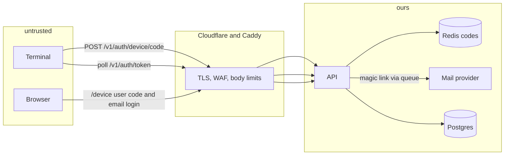
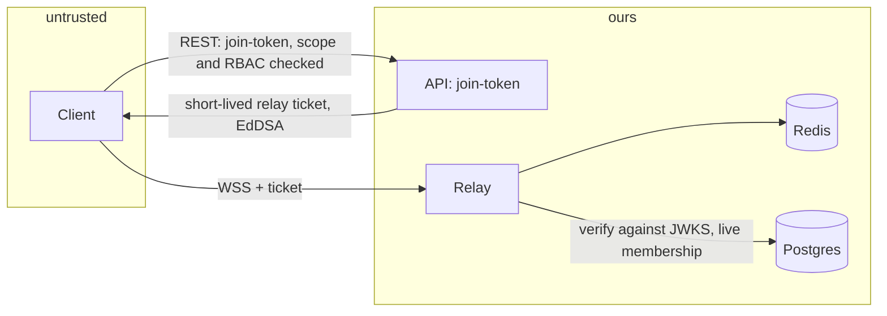
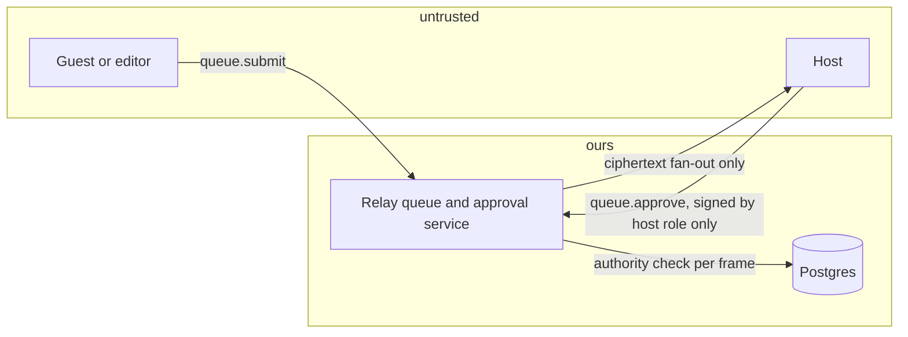
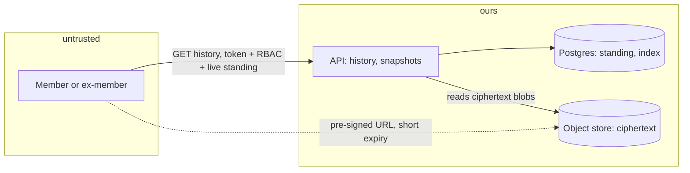
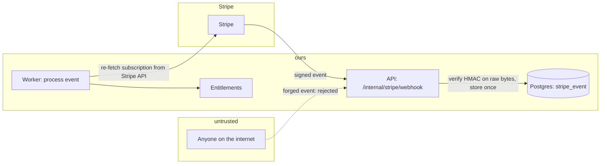
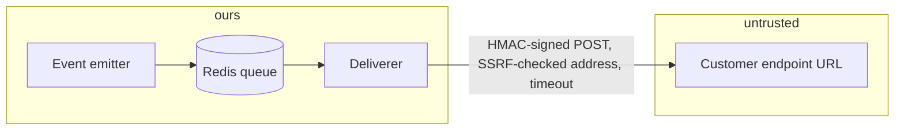

# Threat model and penetration-test preparation

Lane B098. What we protect, from whom, where the trust boundaries are, which controls exist and what proves them,
what is knowingly open, and how an outside tester should approach the system. The tables in this file are
checked by `pnpm pentest:check` (ids are unique and well formed, every owner lane exists, every evidence path
exists), so a renamed test breaks the check instead of rotting here.

The scope is the **backend** (API, relay, worker, admin listener, billing, webhooks, data stores, deploy and
backup scripts). The client has its own threat model; here the client is an untrusted peer and the end-to-end
encryption design ([CT-CRYPTO](../../contracts/05-crypto.md)) is an input: the backend must never see plaintext
work content.

## Assets

| Asset                                                                             | Why it matters                                                         | Where it lives                                                              |
| --------------------------------------------------------------------------------- | ---------------------------------------------------------------------- | --------------------------------------------------------------------------- |
| Account credentials: sessions, refresh tokens, device keys, API keys, magic links | Control of a person's workspaces and billing                           | Postgres (hashed or public keys only), Redis (short-lived), browser cookies |
| Token signing keys (`AUTH_SIGNING_KEYS`)                                          | Anyone holding one can mint any identity                               | `production.env` on the server only; API and worker                         |
| Ciphertext history and snapshots                                                  | Confidential work content, protected by keys the backend does not hold | Object store (MinIO/R2/S3), `history_*` tables                              |
| Entitlement and billing state                                                     | Free use of paid plans, or loss of a paying customer's access          | Postgres (`workspace_entitlements`, `billing_*`)                            |
| Member metadata                                                                   | Names, e-mail addresses, who works with whom, presence                 | Postgres                                                                    |
| Webhook secrets, Stripe keys, mail keys                                           | Forged events, spend, impersonated mail                                | `production.env`, `webhook_endpoints` (encrypted)                           |
| Release manifests                                                                 | A tampered manifest pushes malware through the auto-updater            | Postgres, served by the API; artifacts on a CDN                             |
| Backups                                                                           | A full copy of everything above                                        | Encrypted (`BACKUP_PASSPHRASE`) to an S3 bucket                             |

## Actors

Anonymous visitor; free user; paid member; malicious member (viewer, editor, host of a command post);
workspace admin or owner; Centcom staff (admin listener); compromised device (stolen laptop with a valid
refresh token); malicious host of a shared session; network attacker; malicious webhook receiver; malicious
script on a customer's machine calling the public API; a compromised dependency or CI runner.

## Trust boundaries and data flows

Trust boundaries are drawn as the dashed `untrusted | ours` lines. Only Caddy publishes ports; the admin
listener is on the private network only.

### 1. Device login (RFC 8628)

### 2. Relay join and handshake

### 3. Command-post queue approval

### 4. History and snapshot access

### 5. Billing webhook to entitlement flip

### 6. Outgoing webhook delivery

## STRIDE by component

Columns: id, STRIDE letter (Spoofing, Tampering, Repudiation, Information disclosure, Denial of service,
Elevation of privilege), threat, control, owner lane, evidence (tests or scripts that prove it), status
(`mitigated`, `accepted`, `open`).

### API: sign-in and tokens

| ID         | S   | Threat                                                                                       | Control                                                                                                                                                                                      | Owner | Evidence                                                                                                          | Status    |
| ---------- | --- | -------------------------------------------------------------------------------------------- | -------------------------------------------------------------------------------------------------------------------------------------------------------------------------------------------- | ----- | ----------------------------------------------------------------------------------------------------------------- | --------- |
| TM-AUTH-01 | S   | Attacker forges an access token (algorithm confusion, `none`, wrong key)                     | EdDSA only, `kid` must name a published key, issuer, audience and `typ` checked, 60 s skew                                                                                                   | B017  | `apps/api/test/modules/auth/tokens/jwt.test.ts`, `apps/api/test/modules/auth/tokens/jwks.test.ts`                 | mitigated |
| TM-AUTH-02 | S   | Stolen refresh token replayed                                                                | Rotation with reuse detection: a reused token revokes the family                                                                                                                             | B017  | `apps/api/test/modules/auth/tokens/refresh.test.ts`, `apps/api/test/modules/auth/tokens/revocation.test.ts`       | mitigated |
| TM-AUTH-03 | S   | Guess a device `user_code` or poll with a stolen `device_code`                               | Codes stored only as SHA-256; a user is locked out for 15 minutes after 10 wrong tries in 10 minutes (and an address likewise); unknown, expired, used and foreign codes all answer the same | B016  | `apps/api/test/modules/auth/device/security.test.ts`, `apps/api/test/modules/auth/device/rfc8628.test.ts`         | mitigated |
| TM-AUTH-04 | I   | Account enumeration through the sign-in form                                                 | Same response and timing class whether or not the address has an account                                                                                                                     | B014  | `apps/api/test/modules/auth/magic-link/enumeration.test.ts`                                                       | mitigated |
| TM-AUTH-05 | S   | Mail scanner or link prefetch consumes a one-time sign-in link; link used in another browser | GET shows a confirm form and changes nothing, however often; only the POST consumes the link                                                                                                 | B014  | `apps/api/test/modules/auth/magic-link/prefetch.test.ts`, `apps/api/test/modules/auth/magic-link/service.test.ts` | mitigated |
| TM-AUTH-06 | S   | Open redirect through `return_to` after login                                                | Exact-match allow-list (`LOGIN_RETURN_TO_ALLOWLIST`)                                                                                                                                         | B014  | `apps/api/test/modules/auth/magic-link/redirect.test.ts`, `apps/api/test/modules/auth/social/redirect.test.ts`    | mitigated |
| TM-AUTH-07 | T   | Login CSRF and authorization-code interception on the web flow                               | PKCE (S256), `state`, single-use codes, cookie flags                                                                                                                                         | B018  | `apps/api/test/modules/auth/pkce/pkce.test.ts`, `apps/api/test/modules/auth/pkce/web-cookie.test.ts`              | mitigated |
| TM-AUTH-08 | E   | Account takeover by linking a social identity with an unverified e-mail                      | Linking only on `email_verified`; state binding on the provider callback                                                                                                                     | B015  | `apps/api/test/modules/auth/social/linking.test.ts`, `apps/api/test/modules/auth/social/state.test.ts`            | mitigated |
| TM-AUTH-09 | R   | A revoked device keeps working until the token expires                                       | Revocation list checked on every request; access tokens live 15 minutes                                                                                                                      | B017  | `apps/api/test/modules/auth/tokens/revocation.test.ts`                                                            | mitigated |
| TM-AUTH-10 | D   | Mail bombing a victim through the sign-in form                                               | Per-address and per-client limits, 5 mails per address and template per hour                                                                                                                 | B014  | `apps/api/test/modules/auth/magic-link/limits.test.ts`, `packages/core/test/email/service.test.ts`                | mitigated |
| TM-AUTH-11 | E   | API key leaked in a log or repository gives silent access                                    | Keys hashed at rest, shown once, scoped, revocable; secret scanner in CI and as a pre-commit hook                                                                                            | B019  | `apps/api/test/modules/apikeys`, `infra/security/security.test.ts`                                                | mitigated |

### API: authorization, limits, errors

| ID         | S   | Threat                                                      | Control                                                                                                                                                                                                                                                                                                                                                           | Owner | Evidence                                                                                                                             | Status    |
| ---------- | --- | ----------------------------------------------------------- | ----------------------------------------------------------------------------------------------------------------------------------------------------------------------------------------------------------------------------------------------------------------------------------------------------------------------------------------------------------------- | ----- | ------------------------------------------------------------------------------------------------------------------------------------ | --------- |
| TM-RBAC-01 | E   | Member reaches another workspace's data by guessing ids     | One RBAC engine; roles read from the database; unknown and forbidden both answer 404 for non-members                                                                                                                                                                                                                                                              | B021  | `packages/core/test/rbac/matrix.test.ts`, `apps/api/test/rbac-plugin.test.ts`                                                        | mitigated |
| TM-RBAC-02 | E   | A token's scopes are wider than the route needs             | Every route declares its scope; a coverage test fails for a route without one                                                                                                                                                                                                                                                                                     | B021  | `packages/core/test/rbac/coverage.test.ts`, `packages/core/test/rbac/scopes.test.ts`                                                 | mitigated |
| TM-RBAC-03 | E   | Role fuzzing finds a permission the matrix does not grant   | Property tests over every role and action                                                                                                                                                                                                                                                                                                                         | B021  | `packages/core/test/rbac/can.fuzz.test.ts`                                                                                           | mitigated |
| TM-API-01  | D   | Request flood or one client exhausting capacity             | Redis-backed limits per address and credential, buckets per route class, edge limits at Cloudflare                                                                                                                                                                                                                                                                | B023  | `packages/core/test/ratelimit/buckets.test.ts`, `apps/api/test/rate-limit.test.ts`                                                   | mitigated |
| TM-API-02  | D   | Oversized bodies                                            | 256 KiB default, 1 MiB on batch routes, enforced by Caddy and by the API                                                                                                                                                                                                                                                                                          | B097  | `infra/deploy/deploy.test.ts`, `apps/api/test/telemetry/telemetry.routes.test.ts`                                                    | mitigated |
| TM-API-03  | T   | A retried request runs twice (double charge, double invite) | `Idempotency-Key` middleware: required on money and invite routes, stored replies encrypted                                                                                                                                                                                                                                                                       | B024  | `apps/api/test/idempotency.test.ts`, `apps/api/test/billing/checkout/checkout.idempotency.test.ts`                                   | mitigated |
| TM-API-04  | I   | Stack traces, SQL or paths in error bodies                  | Central problem+json handler with a fixed message table                                                                                                                                                                                                                                                                                                           | B006  | `apps/api/test/error-handler.test.ts`                                                                                                | mitigated |
| TM-API-05  | I   | Tokens, bodies or provider credentials in logs              | The access log records no headers or bodies. Every line the API and the worker write passes the B101 scanner (`createContext` wraps the logger), as do the relay's (`startRelay`): a provider credential becomes `[redacted:<pattern>]` and is counted. Scope: provider credentials (Anthropic, OpenAI, AWS, Google keys, bearer lines), not Centcom's own tokens | B101  | `apps/api/test/access-log.test.ts`, `apps/api/test/secret-guard/mounts.test.ts`, `apps/relay/test/secret-guard/secret-guard.test.ts` | mitigated |
| TM-API-06  | T   | Clickjacking, MIME sniffing, cross-origin reads             | Security headers on every reply; exact-origin CORS, no wildcard                                                                                                                                                                                                                                                                                                   | B097  | `apps/api/test/security-headers.test.ts`                                                                                             | mitigated |
| TM-API-07  | D   | Redis outage turns into an outage of everything             | Degrade policy: reads fail open slowly, required-idempotency routes fail closed with 503                                                                                                                                                                                                                                                                          | B096  | `apps/api/test/chaos/chaos.api.test.ts`                                                                                              | mitigated |
| TM-API-08  | D   | Postgres outage returns success for lost writes             | 503 + `Retry-After`; write ledger proves no acknowledged write is lost, also across a SIGKILL                                                                                                                                                                                                                                                                     | B096  | `apps/api/test/chaos/chaos.crash.test.ts`                                                                                            | mitigated |
| TM-API-09  | R   | A privileged action has no trail                            | Audit events for sign-ins, role changes, billing, admin reads, exports                                                                                                                                                                                                                                                                                            | B036  | `apps/api/test/audit-api/audit.routes.test.ts`                                                                                       | mitigated |

### Relay

| ID          | S   | Threat                                                   | Control                                                                                                                                                      | Owner | Evidence                                                                                                                                                                | Status    |
| ----------- | --- | -------------------------------------------------------- | ------------------------------------------------------------------------------------------------------------------------------------------------------------ | ----- | ----------------------------------------------------------------------------------------------------------------------------------------------------------------------- | --------- |
| TM-RELAY-01 | S   | Replay or reuse of a relay ticket                        | EdDSA ticket valid 60 s (60 s skew, no more), verified against the JWKS; `alg: none`, an HS256 downgrade and keys carried in `jwk`/`jku` headers are refused | B038  | `apps/relay/test/handshake/handshake.ticket.test.ts`, `apps/relay/test/handshake/handshake.jwks.test.ts`                                                                | mitigated |
| TM-RELAY-02 | E   | Join a session without membership or after removal       | Live membership re-read at the handshake and every 2 s; kicked members are dropped                                                                           | B043  | `apps/relay/test/handshake/handshake.access.test.ts`, `apps/relay/test/rooms/rooms.membership-live.test.ts`                                                             | mitigated |
| TM-RELAY-03 | E   | An editor sends `queue.approve` or control commands      | Authority checked per frame against the sender's session role                                                                                                | B051  | `apps/relay/test/control/control.authority.test.ts`, `apps/relay/test/queue/queue.policy.test.ts`, `apps/relay/test/rooms/rooms.authorize.matrix.test.ts`               | mitigated |
| TM-RELAY-04 | I   | **Plaintext leak: log lines**                            | Allow-listed log fields only, AST scan of every `logger` call                                                                                                | B050  | `apps/relay/test/privacy/privacy.logger.test.ts`, `apps/relay/test/privacy/privacy.architecture.test.ts`                                                                | mitigated |
| TM-RELAY-05 | I   | **Plaintext leak: metrics labels**                       | Fixed label sets; canary values never appear in metrics output                                                                                               | B050  | `apps/relay/test/privacy/privacy.metrics.test.ts`, `apps/relay/test/privacy/privacy.canary.test.ts`                                                                     | mitigated |
| TM-RELAY-06 | I   | **Plaintext leak: error messages and close reasons**     | Errors carry codes only; sanitiser strips payload text                                                                                                       | B050  | `apps/relay/test/privacy/privacy.sanitize.test.ts`                                                                                                                      | mitigated |
| TM-RELAY-07 | I   | **Plaintext leak: debug endpoints and dumps**            | No endpoint returns frames; the architecture test forbids reading `ct` outside the codec and store                                                           | B050  | `apps/relay/test/privacy/privacy.architecture.test.ts`, `apps/relay/test/privacy/privacy.vectors.test.ts`                                                               | mitigated |
| TM-RELAY-08 | T   | Malformed or oversized frames crash or confuse the relay | Schema-enforced codec with size limits, fuzzing                                                                                                              | B039  | `apps/relay/test/codec`                                                                                                                                                 | mitigated |
| TM-RELAY-09 | D   | Slow consumer or flood exhausts memory                   | Per-connection watermarks, ephemeral drop, node guard, connection cap                                                                                        | B046  | `apps/relay/test/backpressure/backpressure.watermarks.test.ts`, `apps/relay/test/backpressure/backpressure.isolation.test.ts`, `apps/relay/test/relay.capacity.test.ts` | mitigated |
| TM-RELAY-10 | T   | Frames lost or reordered on reconnect                    | Per-session sequencing, resume from hot buffer or durable log; relay restart under load shows no gap                                                         | B041  | `apps/relay/test/resume/resume.replay.test.ts`, `apps/api/test/chaos/chaos.relay.test.ts`                                                                               | mitigated |
| TM-RELAY-11 | T   | Key-grant or epoch messages manipulated                  | Opaque grants routed only to named devices; stale `kid` refused                                                                                              | B049  | `apps/relay/test/keys/keys.grant-validation.test.ts`, `apps/relay/test/keys/keys.stale-kid.test.ts`                                                                     | mitigated |
| TM-RELAY-12 | D   | Cursor and typing floods                                 | Throttled, unsequenced, size-capped                                                                                                                          | B048  | `apps/relay/test/cursors/cursors.throttle.test.ts`                                                                                                                      | mitigated |

### History, snapshots, share links

| ID         | S   | Threat                                           | Control                                                                                                                          | Owner | Evidence                                                                                                     | Status    |
| ---------- | --- | ------------------------------------------------ | -------------------------------------------------------------------------------------------------------------------------------- | ----- | ------------------------------------------------------------------------------------------------------------ | --------- |
| TM-DATA-01 | I   | An ex-member reads history after removal         | Standing checked on every read, not at join time                                                                                 | B055  | `apps/api/test/history/history.authz.test.ts`                                                                | mitigated |
| TM-DATA-02 | I   | The backend stores or returns plaintext          | Only ciphertext frames are accepted; privacy tests plant canaries                                                                | B055  | `apps/api/test/history/history.privacy.test.ts`, `apps/api/test/snapshots/snapshots.privacy.test.ts`         | mitigated |
| TM-DATA-03 | I   | A pre-signed snapshot URL leaks or is reused     | Uploads are pre-signed with the declared length signed (another length gives another signature); the store refuses anything else | B056  | `apps/api/test/snapshots/snapshots.presign.test.ts`, `apps/api/test/snapshots/snapshots.authz.test.ts`       | mitigated |
| TM-DATA-04 | S   | A guest link is guessed or kept after revocation | Join limits per address (10 a minute), per token (30 a minute) and 20 links per user a minute; guest tickets are viewer-only     | B068  | `apps/api/test/share-links/share-links.join.test.ts`, `apps/api/test/share-links/share-links.limits.test.ts` | mitigated |
| TM-DATA-05 | E   | A viewer guest writes or approves                | Guest tokens are viewer-only by role                                                                                             | B068  | `apps/api/test/share-links/share-links.create-revoke.test.ts`                                                | mitigated |
| TM-DATA-06 | I   | Deleted data survives in a restore               | Purge jobs; **backups are not re-purged**: a restore can bring a deleted account back                                            | B090  | `apps/worker/test/workspace-purge.test.ts`                                                                   | open      |
| TM-DATA-07 | I   | Backups read by whoever finds the bucket         | Encrypted before upload with `BACKUP_PASSPHRASE`, which is kept off the server                                                   | B099  | `infra/dr/dr.test.ts`                                                                                        | mitigated |

### Billing

| ID         | S   | Threat                                                     | Control                                                                                                        | Owner | Evidence                                                                                                                       | Status    |
| ---------- | --- | ---------------------------------------------------------- | -------------------------------------------------------------------------------------------------------------- | ----- | ------------------------------------------------------------------------------------------------------------------------------ | --------- |
| TM-BILL-01 | S   | Forged Stripe webhook flips a plan                         | HMAC-SHA256 on the raw bytes, constant-time compare, 300 s tolerance; the worker re-fetches from Stripe        | B072  | `apps/api/test/billing/webhooks/webhook.signature.test.ts`, `apps/api/test/entrypoint/billing.e2e.test.ts`                     | mitigated |
| TM-BILL-02 | T   | Duplicate or out-of-order events leave the wrong plan      | Stored once per event id; stale-event guard on `created`; convergence test over shuffled events                | B072  | `apps/api/test/billing/webhooks/webhook.idempotency.test.ts`, `apps/api/test/billing/webhooks/webhook.ordering.test.ts`        | mitigated |
| TM-BILL-03 | E   | A member buys or manages billing for a workspace           | Only owner and billing roles; `billing:write` scope                                                            | B071  | `apps/api/test/billing/checkout/checkout.authz.test.ts`                                                                        | mitigated |
| TM-BILL-04 | T   | Client chooses the price or the return URL                 | Prices from the server catalogue; success and cancel URLs from configuration only                              | B071  | `apps/api/test/billing/checkout/checkout.redirects.test.ts`, `apps/api/test/billing/checkout/checkout.validation.test.ts`      | mitigated |
| TM-BILL-05 | E   | Coupon code brute force                                    | Rate limit and generic failure                                                                                 | B079  | `apps/api/test/billing/promotions/promotions.ratelimit.test.ts`, `apps/api/test/billing/promotions/promotions.invalid.test.ts` | mitigated |
| TM-BILL-06 | T   | Usage events inflated to dodge quotas or inflate another's | Events attributed to the device's own user and workspace; batch limits; idempotent                             | B074  | `apps/api/test/usage/ingest/usage.attribution.test.ts`, `apps/api/test/usage/ingest/usage.idempotency-rate.test.ts`            | mitigated |
| TM-BILL-07 | I   | Card data, e-mail or Stripe ids stored or logged           | Only ids and state are stored; the subscription route never returns a Stripe id                                | B070  | `apps/api/test/billing/webhooks/webhook.privacy.test.ts`                                                                       | mitigated |
| TM-BILL-08 | T   | Dunning and trial emails are not driven in the API process | Entitlements derive `past_due` and the grace date from Stripe's status, but no reminder or automatic drop runs | B078  | `docs/billing/going-live.md`                                                                                                   | open      |

### Outgoing webhooks, telemetry, releases

| ID         | S   | Threat                                                                      | Control                                                                                                        | Owner | Evidence                                                                                              | Status    |
| ---------- | --- | --------------------------------------------------------------------------- | -------------------------------------------------------------------------------------------------------------- | ----- | ----------------------------------------------------------------------------------------------------- | --------- |
| TM-HOOK-01 | E   | SSRF: an endpoint URL points at the metadata service or the private network | Resolved addresses checked against private, loopback and link-local ranges at delivery time                    | B081  | `apps/api/test/webhooks/webhooks.ssrf.test.ts`                                                        | mitigated |
| TM-HOOK-02 | S   | Receivers cannot tell a real delivery from a forged one                     | HMAC-SHA256 signature with timestamp, per-endpoint secret                                                      | B081  | `packages/core/test/webhooks/signing.test.ts`                                                         | mitigated |
| TM-HOOK-03 | I   | Event data carries content                                                  | Per-type allow-list of fields; others refused at emit time                                                     | B081  | `apps/api/test/webhooks/webhooks.payload.contract.test.ts`                                            | mitigated |
| TM-HOOK-04 | D   | A slow or hostile receiver ties up workers                                  | Timeouts, retry schedule, dead-letter queue                                                                    | B081  | `apps/api/test/webhooks/webhooks.delivery.test.ts`                                                    | mitigated |
| TM-TELE-01 | I   | Telemetry deanonymises a person                                             | Allow-listed props, no credential read, install id only, always 204                                            | B085  | `apps/api/test/telemetry/telemetry.routes.test.ts`, `apps/api/test/telemetry/telemetry.units.test.ts` | mitigated |
| TM-REL-01  | T   | Release manifest downgrade or tampering                                     | Signed manifests (signature check at publish), `min_client_version`, yanking; artifacts verified by the client | B084  | `apps/api/test/releases/releases.publish.test.ts`                                                     | mitigated |
| TM-REL-02  | E   | The release-signing key is stolen                                           | Key is held by the release pipeline, not by this repo or server                                                | B084  | -                                                                                                     | accepted  |

### Admin, staff, edge, deploy

| ID         | S   | Threat                                                                            | Control                                                                                                                                                                                                                                                                                                                                                                                                                                                                                                                                                                                                                                            | Owner | Evidence                                                                                                                                                                                                       | Status    |
| ---------- | --- | --------------------------------------------------------------------------------- | -------------------------------------------------------------------------------------------------------------------------------------------------------------------------------------------------------------------------------------------------------------------------------------------------------------------------------------------------------------------------------------------------------------------------------------------------------------------------------------------------------------------------------------------------------------------------------------------------------------------------------------------------- | ----- | -------------------------------------------------------------------------------------------------------------------------------------------------------------------------------------------------------------- | --------- |
| TM-ADM-01  | E   | The staff API is reachable from the internet                                      | Own listener, CIDR allow-list, dropped at connect; Caddy answers 404 for `/internal/admin/*`                                                                                                                                                                                                                                                                                                                                                                                                                                                                                                                                                       | B087  | `apps/api/test/admin/admin.listener.test.ts`, `infra/deploy/deploy.test.ts`                                                                                                                                    | mitigated |
| TM-ADM-02  | I   | Staff reads session content or impersonates a user                                | No such endpoints exist; every call, reads included, is audited                                                                                                                                                                                                                                                                                                                                                                                                                                                                                                                                                                                    | B087  | `apps/api/test/admin/admin.routes.test.ts`                                                                                                                                                                     | mitigated |
| TM-EDGE-01 | D   | Volumetric attack on the origin                                                   | Cloudflare in front (proxied records, Full strict), WAF module, per-address limits                                                                                                                                                                                                                                                                                                                                                                                                                                                                                                                                                                 | B097  | `infra/terraform/modules/waf`                                                                                                                                                                                  | accepted  |
| TM-EDGE-02 | S   | Client address spoofed through `X-Forwarded-For`                                  | `TRUSTED_PROXY_HOPS` counts proxies; client IP taken from the right end                                                                                                                                                                                                                                                                                                                                                                                                                                                                                                                                                                            | B023  | `packages/core/test/ratelimit/client-ip.test.ts`                                                                                                                                                               | mitigated |
| TM-OPS-01  | E   | A container escape or a compromised service reaches the others                    | Non-root, read-only root, all capabilities dropped, per-service secrets only, one private network                                                                                                                                                                                                                                                                                                                                                                                                                                                                                                                                                  | B091  | `infra/deploy/deploy.test.ts`                                                                                                                                                                                  | mitigated |
| TM-OPS-02  | T   | A malicious dependency or install script                                          | Exact pins, install scripts never run, allow-list, licence and advisory checks, SBOM                                                                                                                                                                                                                                                                                                                                                                                                                                                                                                                                                               | B097  | `infra/security/security.test.ts`                                                                                                                                                                              | mitigated |
| TM-OPS-03  | I   | Provider credentials in the repository, in requests, frames, telemetry or backups | Repository: scanner (CI + hook) and gitleaks rules. Runtime, mounted: REST hook on every API route (query, path, body, headers except Authorization; 400 `invalid_request`, one body for all patterns; the telemetry route is left to its ingest, which drops the event and answers 204); relay stage 31 on the clear parts of a frame (never `ct` or `sig`; `sys.error invalid_frame`); telemetry events; `backup.sh` scans the dump before encryption and uploads nothing on a hit (exit 6), `restore.sh` scans before `pg_restore`. Not covered: Centcom's own secrets, and `BACKUP_SCAN=skip` turns the backup scan off (the manifest says so) | B101  | `infra/security/security.test.ts`, `apps/api/test/secret-guard/mounts.test.ts`, `apps/api/test/secret-guard/scan-stream.test.ts`, `apps/relay/test/secret-guard/secret-guard.test.ts`, `infra/dr/scan.test.ts` | mitigated |
| TM-OPS-04  | D   | Single server: a reboot or a disk loss is an outage                               | Restart policy, health-gated deploy with rollback, tested restore (26 h worst-case data loss without WAL archiving)                                                                                                                                                                                                                                                                                                                                                                                                                                                                                                                                | B099  | `infra/dr/dr.test.ts`, `infra/deploy/deploy.test.ts`                                                                                                                                                           | accepted  |
| TM-OPS-05  | T   | A bad migration corrupts data                                                     | Forward-only, backward-compatible migrations; backup before migrating; contract migrations need a flag                                                                                                                                                                                                                                                                                                                                                                                                                                                                                                                                             | B092  | `infra/deploy/deploy.test.ts`                                                                                                                                                                                  | mitigated |
| TM-OPS-06  | S   | Mail from our domain is forged                                                    | SPF, DKIM and DMARC at the domain (a human step; see `docs/ops/mail.md`)                                                                                                                                                                                                                                                                                                                                                                                                                                                                                                                                                                           | B032  | `docs/ops/mail.md`                                                                                                                                                                                             | open      |

## Abuse cases, penetration test, disclosure and ASVS

These live in their own files so a tester can be handed each one:

- [`abuse-cases.md`](abuse-cases.md): the requests to try and the response each must get (30 cases, every wire
  contract the backend implements).
- [`pentest-scope.md`](pentest-scope.md): targets, rules of engagement, test accounts (`pnpm pentest:seed`), reporting,
  severity and the tester's checklist. **Status: the test has not been run and no vendor is engaged.**
- [`disclosure-policy.md`](disclosure-policy.md) and [`security.txt.template`](security.txt.template): how outsiders
  report to us (written, not yet published).
- [`asvs-mapping.md`](asvs-mapping.md): ASVS 4.0.3 level 2, chapters V2 to V14, mapped to the controls above.

## Known open items

- **TM-DATA-06**: restoring a backup can resurrect accounts that were deleted after the backup. There is no
  tombstone log yet.
- **TM-BILL-08**: dunning reminders and the automatic drop to the free plan after the grace period are not
  driven in the API process.
- **TM-OPS-06**: SPF, DKIM and DMARC need a domain and DNS access (a human step).
- **Telemetry endpoint**: `POST /v1/telemetry/events` (B085) and its ingest are built and tested but not registered in
  `apps/api/src/modules.ts`, so the live API answers 404 to it. The leak guard is in the ingest and the REST hook
  exempts the route, ready for when it is mounted.
- The pen-test has not been run, `security.txt` and the disclosure policy are not published (they need an owner-chosen
  address and domain), and the ASVS mapping lists its partial rows. No code limits a refresh token to 30 days; the
  pen-test environment is destroyed within 30 days instead (see `pentest-scope.md`).
